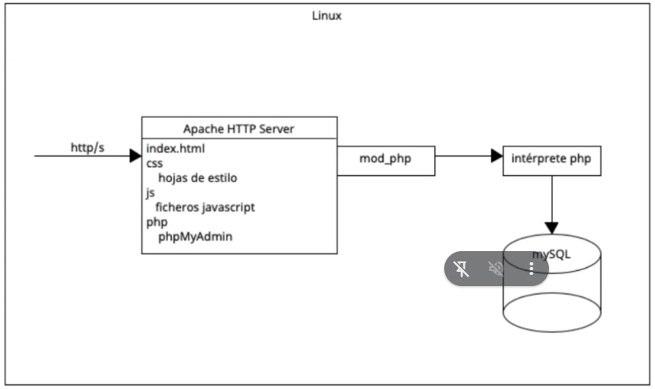

# Getting Started with Cloud Marketplace

## Overview

In this lab, **Google Cloud Marketplace** is used to quickly provision and deploy a pre-configured **LAMP stack** (`LAMP Stack Server on Ubuntu 26.04`) onto a **Compute Engine** virtual machine instance (`lamp-1-vm`) using **Infrastructure Manager**. This demonstrates how turnkey software solutions can be launched on Google Cloud with automated compute, storage, and firewall provisioning.

---

## Stack Architecture & Components

Inside the **Linux (Ubuntu 26.04)** host, incoming **HTTP/HTTPS** requests are handled by the **Apache HTTP Server**, which serves static assets (`index.html`, CSS, JS) and delegates dynamic execution via `mod_php` to the **PHP interpreter** (powering tools such as **phpMyAdmin**) connected to the **MySQL** relational database:

| Component | Role | Key System Path / Config |
| :--- | :--- | :--- |
| **Linux (Ubuntu 26.04)** | Operating system running on the Compute Engine VM | `e2-medium` (2 vCPU, 4 GB RAM, 50 GB Standard Persistent Disk) |
| **Apache HTTP Server** | Web server handling incoming HTTP/HTTPS traffic | Web root: `/var/www/html` \| Config: `/etc/apache2/` |
| **MySQL** | Relational database management system | Data directory: `/var/lib/mysql` |
| **PHP (`mod_php`)** | Server-side web application interpreter | Config: `/etc/php/` |
| **phpMyAdmin** | Web-based MySQL database administration interface | Application files: `/usr/share/phpmyadmin` |

---

## Google Cloud Services & Infrastructure Details

* **Google Cloud Marketplace:** Catalog used to discover and launch `LAMP Stack Server on Ubuntu 26.04` (by *Cloud Infrastructure Services*).
* **Infrastructure Manager / Solution Deployments:** Automated orchestration of deployment `lamp-1` in zone `us-central1-a`.
* **Compute Engine:** Provisioned virtual machine instance `lamp-1-vm` (`e2-medium`, `E2` series) attached to the `default` VPC network.
* **VPC Firewall Rules:** Automatically created `lamp-1-tcp-80` (HTTP) and `lamp-1-tcp-443` (HTTPS) ingress rules to expose the web server externally.

---

## Step-by-Step Execution & Verification Evidence

### Phase 1: Lab Initialization & Marketplace Selection

1. **Lab Environment Setup:** Initialized the sandbox environment in `us-central1` (`us-central1-a`) and authenticated into the Google Cloud Console.
   

2. **GCP Console Sandbox Access:** Accepted the initial workspace/cloud terms for the temporary lab account.
   

3. **Navigating to Cloud Marketplace:** Opened the main Google Cloud Console dashboard and selected **Marketplace** from the navigation menu.
   

4. **Searching the Solution:** Queried `lamp stack server on ubuntu 26.04` in Cloud Marketplace and selected the solution provided by *Cloud Infrastructure Services*.
   

5. **Reviewing Solution Specifications:** Verified the bundled components (Apache, MySQL, PHP, phpMyAdmin, Let's Encrypt) and clicked **Get Started**.
   

6. **Accepting Terms & Agreements:** Reviewed project billing/terms details and accepted the Google Cloud Marketplace and vendor service agreements.
   

7. **Launching Deployment Configuration:** Confirmed agreement acceptance and proceeded to **Deploy**.
   

---

### Phase 2: Infrastructure Configuration & Provisioning

8. **Deployment Name & Zone:** Named the deployment `lamp-1`, selected the Compute Engine default service account, and set the deployment zone to `us-central1-a`.
   

9. **Compute Machine Type:** Configured the machine type to **General purpose → Series `E2` → `e2-medium` (2 vCPU, 4 GB memory)** with a 50 GB Standard Persistent Disk.
   

10. **Networking & Firewall Configuration:** Verified the `default` VPC network interface, enabled **Allow HTTP traffic from the Internet** and **Allow HTTPS traffic from the Internet**, and clicked **Deploy**.
    

11. **Provisioned Resources (`lamp-1`):** Confirmed successful creation of the Compute Engine VM (`lamp-1-vm`) and VPC firewall rules (`lamp-1-tcp-80`, `lamp-1-tcp-443`).
    

12. **Checkpoint Validation:** Verified the deployment objective in the lab progress tracker.
    

---

### Phase 3: HTTP Connectivity Verification & Completion

13. **Deployment Outputs & External IP:** Inspected the **Details** tab of `lamp-1` and retrieved the assigned `Instance Nat Ip` (`34.57.163.113`).
    

14. **HTTP Browser Request:** Navigated to `http://34.57.163.113` over port 80.
    

15. **Live Apache / LAMP Verification:** Confirmed the **Welcome to LAMP on GCP** page loaded successfully, validating that Apache HTTP Server, MySQL, PHP, and phpMyAdmin were active and reachable.
    

16. **Lab Completion:** Completed all assessment checkpoints with a final score of **10 / 10**.
    
